# Filtros de impuestos en facturas (`zub_invoice_tax_filters`)

Módulo para **Odoo 14 Enterprise** (funciona también en Community; solo depende de `account`).
Agrega 8 filtros a la lista de facturas para encontrar facturas según los impuestos de sus líneas.
Cada filtro usa el impuesto que tú eliges.

📄 **Manual en PDF:** [`static/description/manual_usuario.pdf`](static/description/manual_usuario.pdf)

---

# Manual de usuario

## 1. ¿Para qué sirve?

Agrega estos filtros al menú **Filtros** de la lista de facturas:

| "Al menos una línea con…" | "Todas las líneas con…" |
|---|---|
| Al menos una línea con IVA 16% | Todas las líneas con IVA 16% |
| Al menos una línea con IVA 0% | Todas las líneas con IVA 0% |
| Al menos una línea con IVA Exento | Todas las líneas con IVA Exento |
| Al menos una línea con IEPS 8% | Todas las líneas con IEPS 8% |

Puedes activar uno o varios filtros al mismo tiempo. El módulo solo agrega filtros: no cambia
facturas, impuestos ni ningún cálculo de Odoo.

## 2. Antes de empezar

- **Quién configura:** un usuario con el permiso de Contabilidad **Asesor** (administrador de
  contabilidad). Los demás usuarios de facturación pueden **usar** los filtros, pero no ven el menú de
  configuración.
- **Los impuestos deben existir en Odoo** (*Contabilidad › Configuración › Contabilidad › Impuestos*).
  La localización mexicana de Odoo 14 trae *IVA 16% VENTAS*, *IVA 0% VENTAS* e *IEPS 8% COMPRAS*, pero
  **no trae** *IVA Exento* ni *IEPS 8% VENTAS*. Si los usas, deben estar creados en tu empresa para
  poder elegirlos.

## 3. Configurar los filtros

Se configura una sola vez, con un renglón por cada filtro.

**Paso 1.** Entra a **Contabilidad** y abre el menú **Configuración**. En la sección *Contabilidad*,
haz clic en **Filtros de impuestos**.

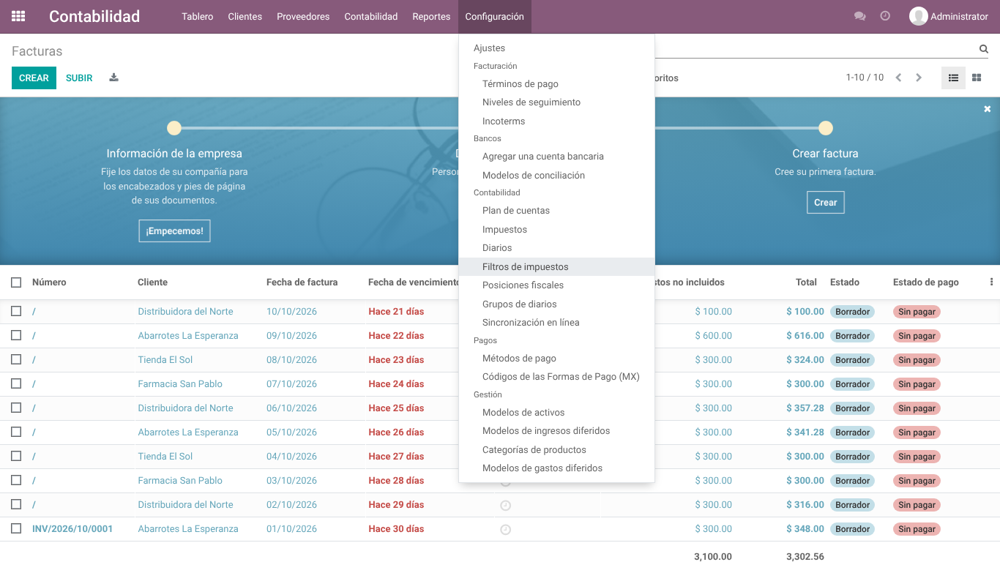

**Paso 2.** La primera vez la lista está vacía. Haz clic en **Crear**.

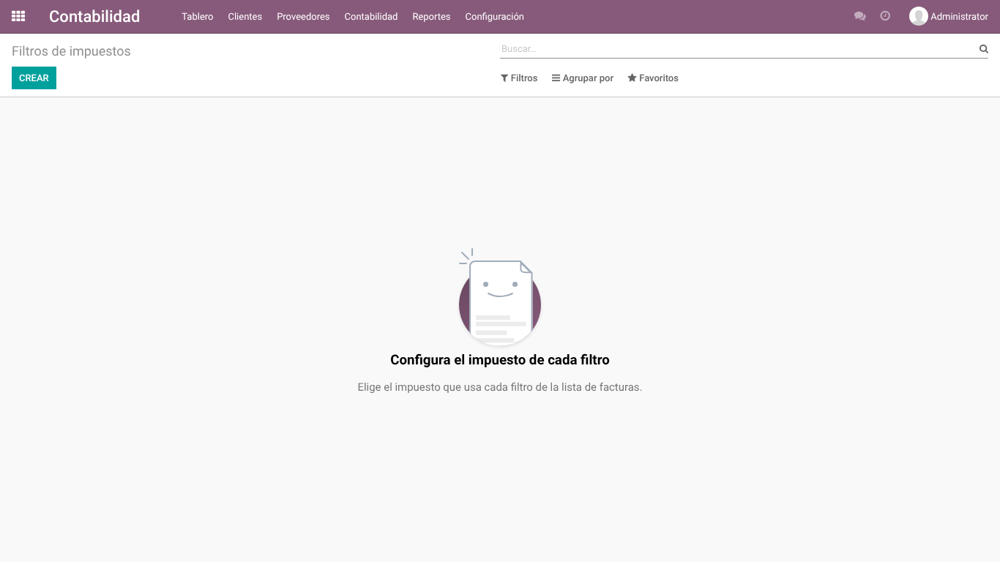

**Paso 3.** Aparece un renglón nuevo. En la columna **Filtro** elige cuál vas a configurar; en el
ejemplo, *Al menos una línea con IVA 16%*.

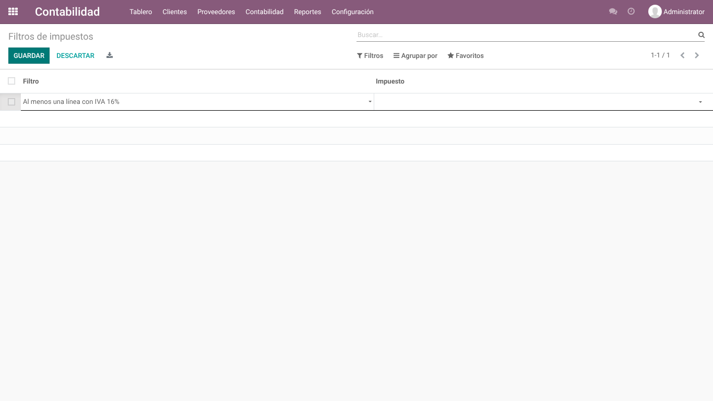

**Paso 4.** En la columna **Impuesto** escribe parte del nombre (por ejemplo *IVA 16*) y elige el
impuesto de la lista. El impuesto es **obligatorio**: sin él no se puede guardar.

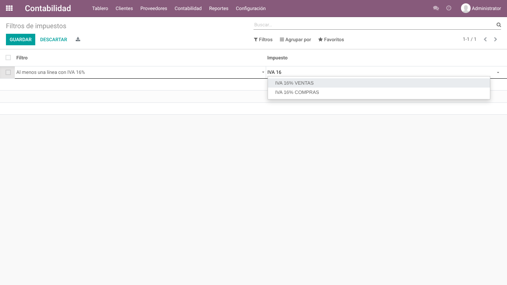

**Paso 5.** Haz clic en **Guardar**.

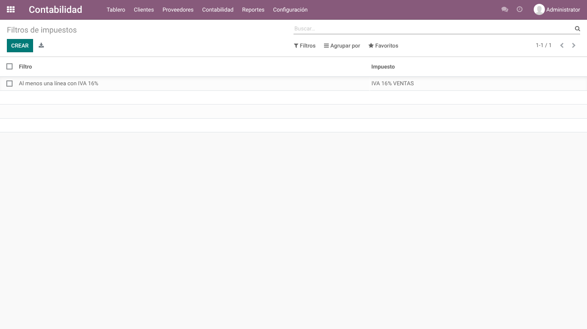

**Paso 6.** Repite los pasos 2 a 5 con los otros 7 filtros. Al terminar, la lista tiene los 8
filtros, cada uno con su impuesto.

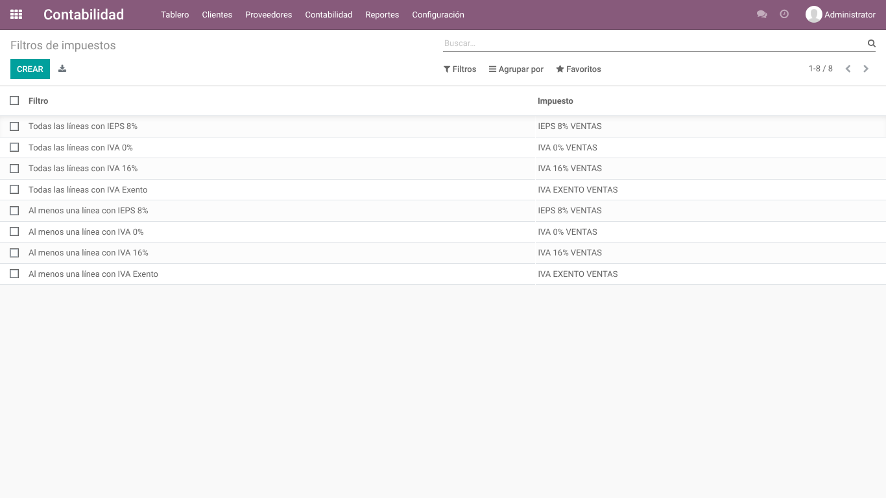

> **Cambiar el impuesto de un filtro:** haz clic en su renglón, cambia el impuesto y guarda.
> El cambio se aplica de inmediato la próxima vez que se use el filtro.
>
> Cada filtro admite **un solo impuesto por empresa**. Si intentas crear el mismo filtro dos veces,
> Odoo lo impide.

## 4. Usar los filtros en la lista de facturas

**Paso 1.** Abre **Contabilidad › Clientes › Facturas**; también funciona en las facturas de
proveedor y en las notas de crédito. Haz clic en **Filtros**: los 8 filtros nuevos aparecen al final
del menú.

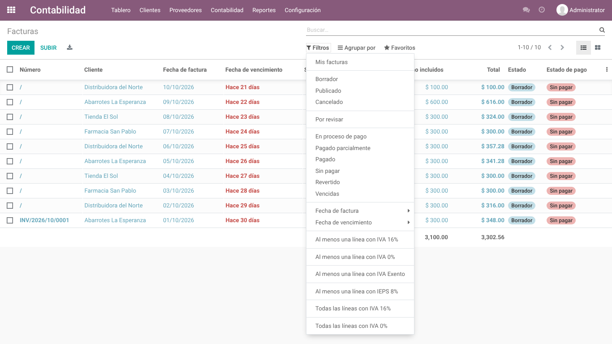

**Paso 2.** Haz clic en un filtro, por ejemplo *Al menos una línea con IEPS 8%*. La lista muestra
solo las facturas que cumplen.

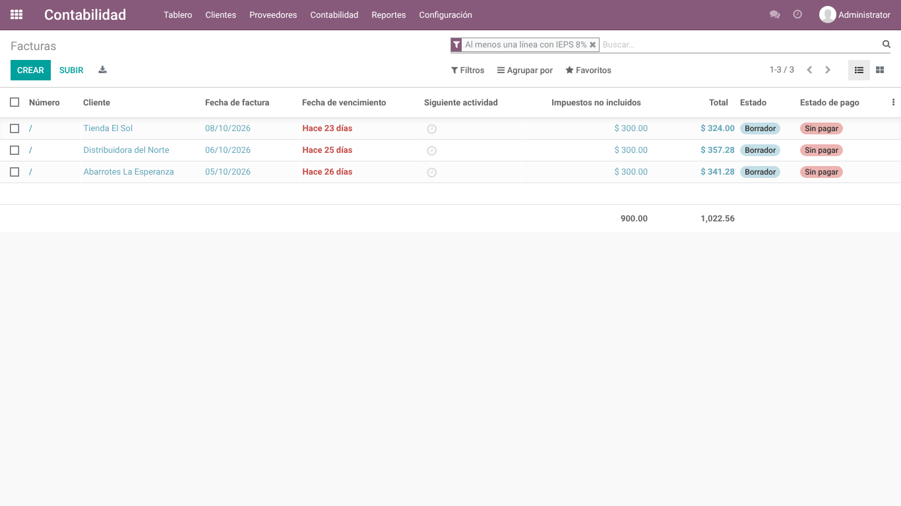

**Paso 3. Combinar filtros:** vuelve a abrir **Filtros** y haz clic en otro, por ejemplo *Al menos
una línea con IVA 16%*. Los filtros se suman con **"Y"**: solo se ven las facturas que cumplen
**todas** las condiciones activas.


**Paso 4.** Puedes abrir cualquier factura del resultado para comprobar sus impuestos. Esta aparece
porque una de sus líneas lleva IEPS 8% junto con IVA 16%:

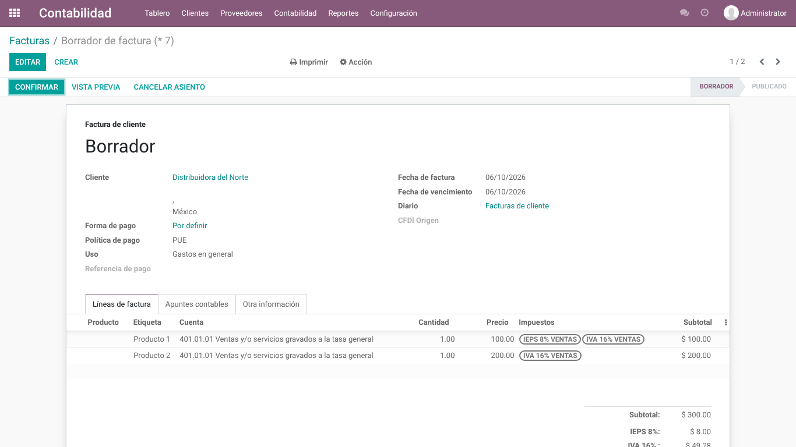

**Paso 5. Quitar un filtro:** haz clic en la **×** de su etiqueta en la barra de búsqueda. También
puedes desmarcarlo en el menú **Filtros**.

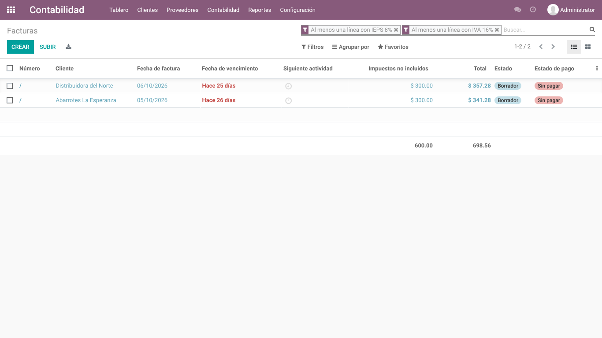

**Paso 6.** Los filtros **"Todas las líneas con…"** muestran las facturas en las que **cada** línea
lleva el impuesto. Ejemplo: *Todas las líneas con IVA 16%*.

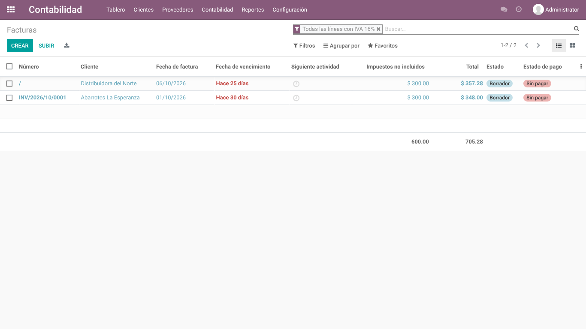

> **Guardar una búsqueda frecuente:** con los filtros activos, abre **Favoritos › Guardar búsqueda
> actual**, ponle nombre y guarda. Es la función normal de Odoo.

## 5. Cómo decide el filtro qué facturas muestra

- **Una línea cuenta si entre sus impuestos está el configurado**, aunque también tenga otro. Una
  línea puede llevar uno o dos impuestos; por ejemplo, IEPS 8% con o sin IVA.
- Solo cuentan las **líneas de producto**; las secciones y notas se ignoran.
- **"Al menos una línea con X":** la factura aparece si alguna de sus líneas lleva X.
- **"Todas las líneas con X":** la factura aparece si cada una de sus líneas lleva X.
- **Varios filtros activos:** se combinan con "Y".

Ejemplos con facturas de dos líneas (✓ = la factura aparece con ese filtro):

| Línea 1 | Línea 2 | Al menos IVA 16% | Todas IVA 16% | Al menos IEPS 8% | Todas IEPS 8% | Al menos IVA 0% |
|---|---|:-:|:-:|:-:|:-:|:-:|
| IVA 16% | IVA 16% | ✓ | ✓ | | | |
| IVA 16% | IVA 0% | ✓ | | | | ✓ |
| IEPS 8% + IVA 16% | IVA 16% | ✓ | ✓ | ✓ | | |
| IEPS 8% + IVA 16% | IEPS 8% | ✓ | | ✓ | ✓ | |
| IEPS 8% | IEPS 8% + IVA 0% | | | ✓ | ✓ | ✓ |
| IVA Exento | IVA Exento | | | | | |

La factura con IVA Exento en todas sus líneas aparece con *Al menos una línea con IVA Exento* y con
*Todas las líneas con IVA Exento*.

## 6. Mensaje "no tiene un impuesto configurado"

Si usas un filtro al que todavía no se le eligió impuesto, Odoo muestra este aviso y no filtra. Pide a
un Asesor contable que lo configure (sección 3) y vuelve a intentarlo.

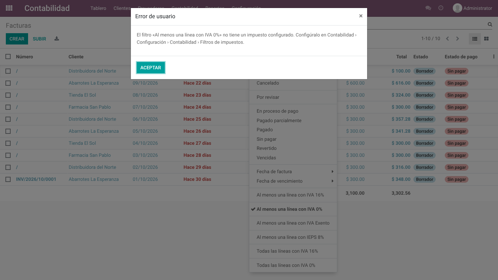

## 7. Preguntas frecuentes

**¿Por qué un filtro no encuentra mis facturas de proveedor?** En Odoo los impuestos de ventas y de
compras son impuestos distintos; por ejemplo, *IVA 16% VENTAS* e *IVA 16% COMPRAS*. Cada filtro usa
**un solo** impuesto: uno de ventas encuentra facturas de cliente y uno de compras encuentra facturas
de proveedor.

**Tengo varias empresas, ¿cómo funciona?** Cada empresa configura sus filtros con sus propios
impuestos. El filtro aplica en las empresas que tengas seleccionadas en ese momento.

**¿Qué pasa si se borra un impuesto que estaba configurado?** Se borra también su renglón de
configuración y ese filtro queda "sin configurar" (sección 6). No afecta nada más.

**¿Qué pasa si se desinstala el módulo?** Desaparecen los filtros y su pantalla de configuración. Las
facturas, sus líneas y los impuestos **no se modifican**. Los favoritos que usaban estos filtros se
**archivan** (no se borran), para que la lista de facturas siga abriendo sin errores.

---

# Notas técnicas

## No invasivo

- Los 8 campos agregados a `account.move` (`zub_any_*`, `zub_all_*`) **no se almacenan**: no crean
  columnas y solo se usan para buscar. No cambia ningún cálculo ni flujo de Odoo.
- No sobrescribe ningún método de Odoo: todos los métodos son nuevos y llevan el prefijo `zub_`.
  Hereda una sola vista, la de búsqueda de facturas (`account.view_account_invoice_filter`), con un
  `xpath`.
- La configuración vive en su propio modelo `zub.invoice.tax.filter`, con ACL solo para
  `account.group_account_manager` y una regla multiempresa. Al desinstalar se borra solo esa
  configuración.
- `tax_id` usa `ondelete="cascade"`: borrar un impuesto borra su configuración en lugar de bloquear
  a Odoo.
- `uninstall_hook` **archiva** (no borra) los favoritos (`ir.filters`) que usan estos filtros. Sin él,
  un favorito predeterminado con un filtro del módulo haría fallar la lista de facturas de ese usuario
  después de desinstalar (se comprobó en navegador).

## Pruebas

```bash
odoo-bin -d <bd> -i l10n_mx,zub_invoice_tax_filters --test-tags /zub_invoice_tax_filters --stop-after-init
```

Usan el plan contable mexicano (`l10n_mx.mx_coa`) y sus impuestos nativos; si `l10n_mx` no está
instalado, se omiten. Con líneas de 0 a 2 impuestos verifican cada filtro y cada par de filtros
combinados contra un oráculo independiente, en facturas de cliente y de proveedor. También cubren
negación, aviso sin configuración, permisos, multiempresa, borrado de un impuesto configurado y el
hook de desinstalación.
